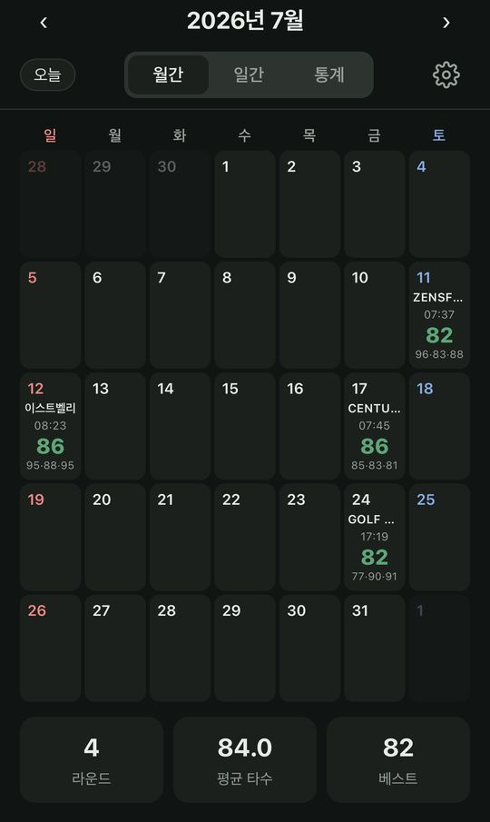
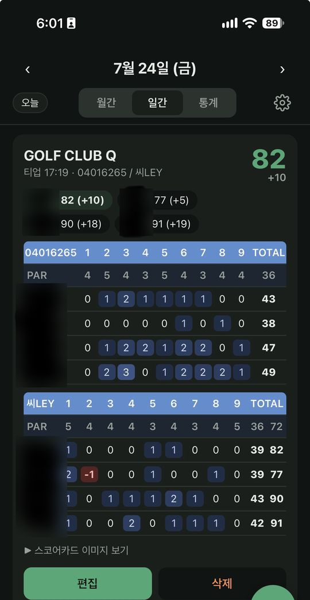
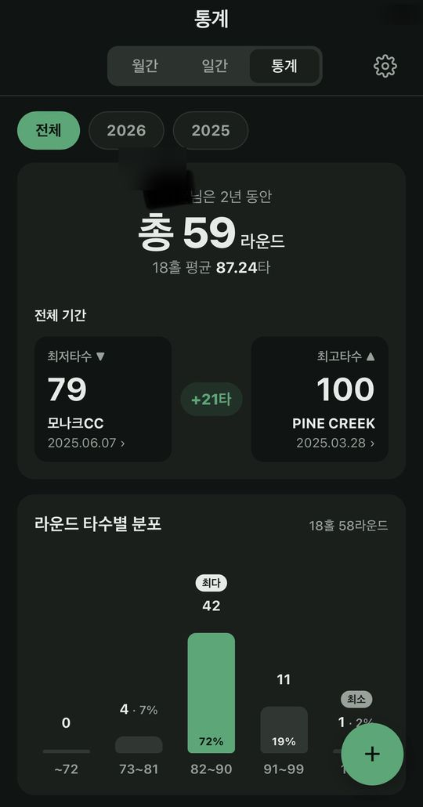
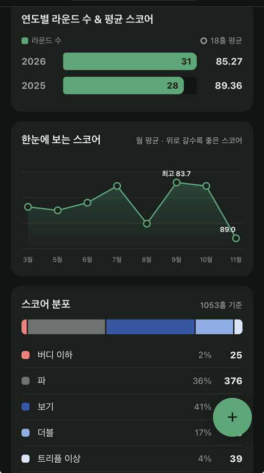
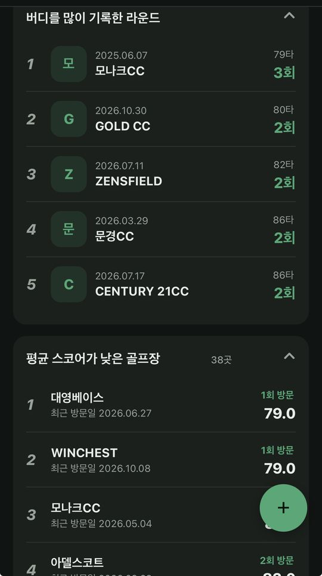
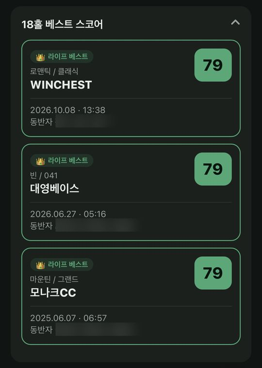

# ⛳ 골력 (골프 달력)

  <a href="https://jaygoo13.github.io/test/"><b>📱 앱 열기 → jaygoo13.github.io/test</b></a>  
   
  PC에서 보고 있다면 폰 카메라로 QR을 찍으세요

## 🚀 30초 사용법 (폰 기준)

| 단계 | 할 일 |
|:---:|---|
| **1** | 폰에서 **[앱 열기](https://jaygoo13.github.io/test/)** (아이폰은 **Safari**, 안드로이드는 **Chrome** 권장) |
| **2** | 화면 위 초록색 **[📲 홈 화면에 추가]** 버튼 누르기 • **안드로이드**: 설치 창이 바로 뜹니다 → **설치** • **아이폰**: 안내대로 공유 버튼 <kbd>□↑</kbd> → **홈 화면에 추가** → **추가** |
| **3** | 이제부터는 **홈 화면의 ⛳ 아이콘**으로 실행 |
| **4** | 오른쪽 아래 **＋** → **스코어카드 이미지로 추가** → 사진 선택 (여러 장 가능) |
| **5** | 인식 결과 확인 → 골프장 확인/선택 → **저장** ✅ |
| **6** | (선택) 편집 → **📷 그날의 사진 · 메모**에 사진과 일기 남기기 |

> ⚠️ **카카오톡 등 메신저에서 링크를 열었다면** 홈 화면에 추가가 안 됩니다. 버튼을 누르면 Safari/Chrome으로 다시 열어줍니다.
>
> 💾 기록은 **내 폰에만** 저장됩니다. 가끔 **⚙︎ 설정 → 백업 내보내기**로 백업해 두세요.

**화면 구성**: 상단 **월간** (달력에 골프장·티업·내 타수·동반자 타수) · **일간** (홀별 스코어표, 편집/삭제) · **통계** (연도별·월별 평균, 타수 분포, 베스트 스코어 등)

---

## 📸 화면 미리보기

| | |
|:---:|:---:|
|  |  |
| **월간** — 날짜마다 골프장·티업 시간·내 타수·동반자 타수 | **일간** — 원본 카드처럼 파 대비 스코어표, 편집·삭제 |
|  |  |
| **통계** — 총 라운드, 최저·최고 타수, 타수 구간 분포 | **추이** — 연도별 평균, 월 평균 그래프, 홀 스코어 분포 |
|  |  |
| **순위** — 버디 많은 라운드, 평균 스코어 낮은 골프장 | **베스트** — 18홀 베스트 스코어 Top 3 |

골프장 목록 출처: GitHub 공개 저장소 woongeeeee/golf-tee, yourshlee/Korean-Golf-Course01 (이름·지역만 사용)
